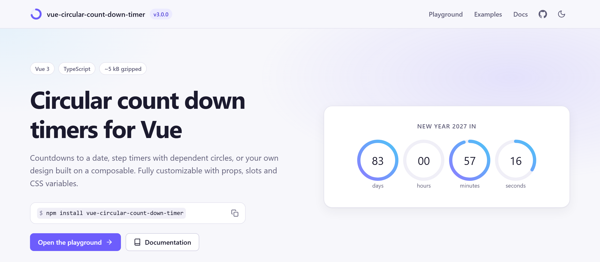

# Vue Circular Count Down Timer

[](https://www.npmjs.com/package/vue-circular-count-down-timer)
[](LICENSE)
[](https://vuejs.org/)

Fully customizable circular count down timers for Vue 3: countdowns to a date or for a duration, step timers with dependent circles, and a composable to build your own design.

**[Open the playground and examples →](https://noorzaie.github.io/vue-circular-count-down-timer/)**



## Features

- **Two timers**: `CircularTimeCountDown` counts down to a date or for a duration; `CircularCountDownTimer` moves circles step by step, with dependent circles and stop conditions.
- **Controls**: start, pause, resume and reset through a template ref, with events for every change.
- **Accurate**: based on the clock, so timers don't drift and catch up after the browser throttles a background tab.
- **Customizable**: props for every circle or per circle, `value` and `label` slots, value formatting, and CSS variables for theming.
- **Build your own**: the `useCountdown` composable and the `CountDownCircle` component.
- **TypeScript** types, an accessible `role="timer"`, SSR-safe, and about 5 kB gzipped with styles included.

## Contents

- [Installation](#installation)
- [CircularTimeCountDown](#circulartimecountdown)
- [CircularCountDownTimer](#circularcountdowntimer)
- [Appearance options](#appearance-options)
- [Controlling a timer](#controlling-a-timer)
- [Slots](#slots)
- [Theming with CSS variables](#theming-with-css-variables)
- [Build your own: useCountdown and CountDownCircle](#build-your-own-usecountdown-and-countdowncircle)
- [TypeScript](#typescript)
- [Accessibility](#accessibility)
- [Migrating from version 2](#migrating-from-version-2)
- [Development](#development)

## Installation

```
npm install vue-circular-count-down-timer
```

Version 3 requires **Vue 3.5 or later**. For Vue 2, install version 2: `npm install vue-circular-count-down-timer@2`.

Import the components where you use them:

```vue
<script setup>
import { CircularTimeCountDown } from 'vue-circular-count-down-timer';
</script>
```

Or register all components globally in your `main.js`:

```js
import { createApp } from 'vue';
import CircularCountDownTimer from 'vue-circular-count-down-timer';
import App from './App.vue';

createApp(App)
    .use(CircularCountDownTimer)
    .mount('#app');
```

Styles are included in the JavaScript bundle, so there is no CSS file to import.

Without a build step, load it from a CDN after Vue:

```html
<script src="https://unpkg.com/vue@3"></script>
<script src="https://unpkg.com/vue-circular-count-down-timer@3"></script>
<script>
    Vue.createApp({ /* ... */ })
        .use(VueCircularCountDownTimer.default)
        .mount('#app');
</script>
```

## CircularTimeCountDown

Counts down to a date (`end`) or for a duration in milliseconds (`duration`), with one circle per time unit.

```vue
<template>
    <!-- Until New Year, in days, hours, minutes and seconds -->
    <CircularTimeCountDown :end="new Date('2027-01-01T00:00:00')" :size="90" />

    <!-- 5 minutes, in minutes and seconds -->
    <CircularTimeCountDown
        :duration="5 * 60 * 1000"
        :units="['minutes', 'seconds']"
        :format-value="(value) => String(value).padStart(2, '0')"
        @finished="onFinished"
    />
</template>
```

The largest unit holds everything above it: 50 hours with `units: ['hours', 'minutes']` shows 50 hours. Its circle starts full; the other circles use their natural range (24 hours, 60 minutes, 60 seconds).

### Props

All [appearance options](#appearance-options) are also available.

| Prop | Description | Type | Default |
| --- | --- | --- | --- |
| `end` | Date to count down to. Takes precedence over `duration`. | `Date \| number \| string` | |
| `duration` | Time to count down from, in ms. | `number` | |
| `units` | Units to show. They are always shown from largest to smallest. | `('days' \| 'hours' \| 'minutes' \| 'seconds')[]` | all four |
| `labels` | Labels of the units, e.g. for translations. An empty string hides a label. | `{ days?: string, ... }` | unit names |
| `circle-options` | [Appearance options](#appearance-options), `steps`, `label` and `classList` per unit. | `{ days?: {...}, ... }` | `{}` |
| `autostart` | Start counting when the component is mounted. | `boolean` | `true` |
| `container-classes` | Classes of the container element. | `string[]` | `[]` |
| `circle-classes` | Classes of each circle element. | `string[]` | `[]` |
| `aria-label` | Accessible name of the timer. | `string` | values and labels |

Changing `end` or `duration` resets the countdown.

### Events

| Event | Payload | Description |
| --- | --- | --- |
| `update` | `{ days?, hours?, minutes?, seconds?, remaining }` | Every time the smallest unit changes. `remaining` is in ms. |
| `finished` | | The countdown reached zero. |
| `started` | | The countdown started or resumed. |
| `paused` | | The countdown was paused. |
| `reset` | | The countdown was reset. |

With `duration`, pausing freezes the remaining time. With `end`, pausing only stops the updates: the end date doesn't move, so resuming jumps to the real remaining time.

## CircularCountDownTimer

Moves the main circle one step every `interval` ms. Circles can depend on each other, like the hands of a clock.

```vue
<template>
    <CircularCountDownTimer
        :circles="circles"
        main-circle-id="seconds"
        :stop-conditions="{ minutes: 0, seconds: 0 }"
        :size="100"
        @update="onUpdate"
        @finished="onFinished"
    />
</template>

<script setup>
import { CircularCountDownTimer } from 'vue-circular-count-down-timer';

const circles = [
    { id: 'minutes', steps: 60, value: 1, stepLength: -1, label: 'minutes' },
    { id: 'seconds', steps: 60, value: 30, stepLength: -1, label: 'seconds', dependentCircles: ['minutes'] }
];
</script>
```

Define `circles` in your script rather than inline in the template: a new array resets the timer, and an inline array is recreated on every render.

- **Steps**: a circle holds `steps` values, from `startValue` to `startValue + steps - 1`, and wraps around.
- **Dependent circles**: each time a circle wraps around, the circles in its `dependentCircles` move one step.
- **Counting down**: a negative `stepLength` makes a circle count down.
- **Stop conditions**: the timer stops and emits `finished` when all circles in `stop-conditions` reach their values.
- **Arrangement**: circles are placed in a row; change the layout with `container-classes` and `circle-classes`.

### Props

All [appearance options](#appearance-options) are also available and apply to every circle.

| Prop | Description | Type | Default |
| --- | --- | --- | --- |
| `circles` | Circles configuration, see [circle options](#circle-options). | `CircleConfig[]` | `[]` |
| `main-circle-id` | Id of the circle that moves on every step. **Required.** | `string \| number` | |
| `interval` | Time between steps in ms. | `number` | `1000` |
| `stop-conditions` | Circle values (by circle id) at which the timer stops. | `{ [id]: number }` | `{}` |
| `trigger-update` | Emit an `update` event on every step. | `boolean` | `true` |
| `autostart` | Start counting when the component is mounted. | `boolean` | `true` |
| `container-classes` | Classes of the container element. | `string[]` | `[]` |
| `circle-classes` | Classes of each circle element. | `string[]` | `[]` |
| `aria-label` | Accessible name of the timer. | `string` | values and labels |

### Circle options

Each circle can also set any of the [appearance options](#appearance-options), which override the props of the component.

| Option | Description | Type | Default |
| --- | --- | --- | --- |
| `id` | Id of the circle. **Required.** | `string \| number` | |
| `steps` | Number of values of the circle. **Required.** | `number` | |
| `value` | Initial value. | `number` | `0` |
| `startValue` | First value of the circle, used after it wraps around. | `number` | `0` |
| `stepLength` | How much the value changes on each step. Negative counts down. | `number` | `1` |
| `dependentCircles` | Ids of circles that move one step each time this circle wraps around. | `(string \| number)[]` | `[]` |
| `label` | Label of the circle. | `string` | |
| `classList` | Classes of the circle element; replaces `circle-classes`. | `string[]` | |

### Events

| Event | Payload | Description |
| --- | --- | --- |
| `update` | `{ [id]: number }` | Values of all circles after each step. |
| `finished` | | The stop conditions were reached. |
| `started` | | The timer started or resumed. |
| `paused` | | The timer was paused. |
| `reset` | | The timer was reset. |

## Appearance options

Available as props on both timers, as options per circle or per unit, and as props of `CountDownCircle`.

| Option | Description | Type | Default |
| --- | --- | --- | --- |
| `size` | Width and height of the circles in px. `0` fits the circles to the height of their container. | `number` | `0` |
| `stroke-width` | Thickness of the circle strokes in px. | `number` | `10` |
| `stroke-color` | Color of the filled part. | `string` | `#9d989b` |
| `underneath-stroke-color` | Color of the empty part. | `string` | `#eee` |
| `fill-color` | Background color of the circles. | `string` | `#ffffff` |
| `value-font-size` | Font size of the values in px. | `number` | `20` |
| `label-font-size` | Font size of the labels in px. | `number` | `15` |
| `label-position` | Position of the labels. | `'bottom' \| 'top'` | `'bottom'` |
| `show-value` | Show the values inside the circles. | `boolean` | `true` |
| `stroke-linecap` | Shape of the ends of the filled part. | `'butt' \| 'round' \| 'square'` | `'butt'` |
| `direction` | Direction the circles fill in. | `'clockwise' \| 'counterclockwise'` | `'clockwise'` |
| `format-value` | Formats the displayed values. | `(value: number) => string \| number` | |

The default colors and font sizes come from [CSS variables](#theming-with-css-variables), so you can also set them with CSS.

## Controlling a timer

Both timers expose methods and state through a template ref. Use `autostart: false` to start them yourself.

```vue
<template>
    <CircularTimeCountDown ref="timer" :duration="25 * 60 * 1000" :autostart="false" />
    <button @click="timer.start()">Start</button>
    <button @click="timer.pause()">Pause</button>
    <button @click="timer.resume()">Resume</button>
    <button @click="timer.reset()">Reset</button>
</template>

<script setup>
import { useTemplateRef } from 'vue';
import { CircularTimeCountDown } from 'vue-circular-count-down-timer';

const timer = useTemplateRef('timer');
</script>
```

| Member | Description |
| --- | --- |
| `start()` | Starts the timer, or restarts it from the beginning if it has finished. |
| `pause()` | Pauses the timer. |
| `resume()` | Continues a paused timer. |
| `reset()` | Stops the timer and restores its initial values. |
| `isRunning` | Whether the timer is running. |
| `isFinished` | Whether the timer has finished. |
| `values` | `CircularCountDownTimer` only: current value of each circle. |
| `remaining` | `CircularTimeCountDown` only: remaining time in ms. |

## Slots

The `value` slot replaces the value inside a circle and the `label` slot replaces its label.

```vue
<CircularTimeCountDown :duration="90 * 60 * 1000" :units="['hours', 'minutes', 'seconds']">
    <template #value="{ value, unit }">
        <strong>{{ value }}</strong><small>{{ unit[0] }}</small>
    </template>
    <template #label="{ label }">
        {{ label.toUpperCase() }}
    </template>
</CircularTimeCountDown>
```

| Slot | Props |
| --- | --- |
| `value` | `value`, `formattedValue`, `steps`, and `circle` (`CircularCountDownTimer`) or `unit` (`CircularTimeCountDown`) |
| `label` | `label`, `value`, and `circle` or `unit` |

## Theming with CSS variables

Set these custom properties on any parent element to theme every timer inside it. Props take precedence over the variables.

```css
.my-theme {
    --cdt-stroke-color: #6d5dfc;
    --cdt-underneath-stroke-color: #ecebff;
    --cdt-value-color: #1b1a2e;
}
```

| Variable | Default |
| --- | --- |
| `--cdt-stroke-color` | `#9d989b` |
| `--cdt-underneath-stroke-color` | `#eee` |
| `--cdt-fill-color` | `#ffffff` |
| `--cdt-value-color` | `inherit` |
| `--cdt-label-color` | `inherit` |
| `--cdt-value-font-size` | `20px` |
| `--cdt-label-font-size` | `15px` |
| `--cdt-transition-duration` | `0.5s` |
| `--cdt-circle-margin` | `5px` |

Stroke colors can also be SVG paint servers, such as a gradient defined elsewhere on the page: `--cdt-stroke-color: url(#my-gradient)`.

## Build your own: useCountdown and CountDownCircle

`useCountdown` provides the countdown logic of `CircularTimeCountDown` for your own markup. `CountDownCircle` is a single circle you can place anywhere, and `splitTime` splits milliseconds into units.

```vue
<template>
    <CountDownCircle :value="Math.ceil(remaining / 1000)" :steps="total / 1000" :size="150">
        <template #value>{{ time.minutes }}:{{ String(time.seconds).padStart(2, '0') }}</template>
    </CountDownCircle>
    <button @click="isRunning ? pause() : start()">{{ isRunning ? 'Pause' : 'Start' }}</button>
</template>

<script setup>
import { computed } from 'vue';
import { CountDownCircle, splitTime, useCountdown } from 'vue-circular-count-down-timer';

const { remaining, total, isRunning, start, pause } = useCountdown({ duration: 90 * 1000 });
const time = computed(() => splitTime(remaining.value, ['minutes', 'seconds']));
</script>
```

`useCountdown(options)` accepts values, refs or getters for its options:

| Option | Description | Default |
| --- | --- | --- |
| `end` | Date to count down to. Takes precedence over `duration`. | |
| `duration` | Time to count down from, in ms. | |
| `precision` | How often `remaining` is updated, in ms. | `1000` |
| `autostart` | Start when the component is mounted. | `true` |
| `onTick`, `onFinish`, `onStart`, `onPause`, `onReset` | Callbacks. | |

It returns `remaining` and `total` (in ms), `isRunning`, `isFinished`, `start`, `pause`, `resume` and `reset`. The timer stops automatically when the component unmounts.

`splitTime(ms, units?)` returns `{ days, hours, minutes, seconds }` for the given units. The smallest unit is rounded up, so a countdown shows its full starting value and reaches zero exactly when it ends.

## TypeScript

The package ships with types. Components are typed for props, events, slots and template refs, and these types are exported:

```ts
import type {
    CircleConfig,          // a circle of CircularCountDownTimer
    CircleAppearance,      // the appearance options
    CircleValues,          // payload of the update event of CircularCountDownTimer
    StopConditions,
    TimeUnit,              // 'days' | 'hours' | 'minutes' | 'seconds'
    TimeUpdate,            // payload of the update event of CircularTimeCountDown
    TimeUnitCircleOptions, // circle-options of CircularTimeCountDown
    UseCountdownOptions,
    UseCountdownReturn
} from 'vue-circular-count-down-timer';
```

Registering the plugin with `app.use()` also types the global components in templates.

## Accessibility

Timers have `role="timer"` and an `aria-label` made of the values and labels of the circles, such as "01 minutes, 30 seconds". Set the `aria-label` prop to provide your own. The SVG circles are hidden from screen readers.

## Migrating from version 2

Most apps only need to change how the plugin is registered: `app.use(CircularCountDownTimer)` instead of `Vue.use(CircularCountDownTimer)`. Also check:

- **Vue 3.5+** is required. Vue 2 reached end of life on December 31, 2023; version 2 of this package keeps working with it.
- **Imports**: the files in `dist` were renamed. Import from the package root.
- **`startValue`**: a circle now holds `steps` values from `startValue` to `startValue + steps - 1`. Before, a circle counting up with `startValue: 1, steps: 12` never showed 12.
- **Default colors and font sizes** now come from CSS variables. Nothing changes visually unless you set the variables.
- **`undefined` circle options** now fall back to the options of the component.
- **Background tabs**: after the browser throttles timers, the timer catches up in a single `update` event instead of a burst of events.

See the [changelog](CHANGELOG.md) for all changes.

## Development

```
npm install
npm run dev                 # playground with hot reload (playground/)
npm test                    # unit tests (tests/)
npm run lint
npm run type-check
npm run build               # library and types in dist/
npm run build:playground    # GitHub Pages site in playground-dist/
npm run deploy:playground   # builds the site and pushes it to the gh-pages branch
```

The playground imports the library from `src/`. Its examples in `playground/src/examples/` are shown live on the site along with their source code.

## License

[MIT](LICENSE)
