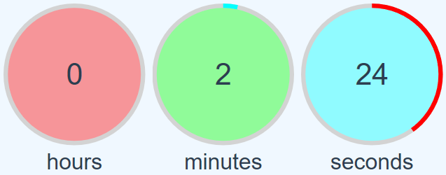

# Circular count down timer
This library is a count down timer for Vue js framework. You can add as many as timers you need and fully customize them.



## Installation
```
npm install vue-circular-count-down-timer
```
> Version 3 requires **Vue 3.5+**. If you are still on Vue 2, install version 2: `npm install vue-circular-count-down-timer@2`

Register the component globally in your `main.js`:
```js
import { createApp } from 'vue';
import CircularCountDownTimer from 'vue-circular-count-down-timer';
import App from './App.vue';

createApp(App)
    .use(CircularCountDownTimer)
    .mount('#app');
```

Or import it only in the components that use it:
```vue
<script setup>
import { CircularCountDownTimer } from 'vue-circular-count-down-timer';
</script>
```

Styles are bundled with the component, so there is no CSS file to import.

You can also use it directly in the browser without a build step:
```html
<script src="https://unpkg.com/vue@3"></script>
<script src="https://unpkg.com/vue-circular-count-down-timer@3"></script>
<script>
    Vue.createApp({ /* ... */ })
        .use(VueCircularCountDownTimer.default)
        .mount('#app');
</script>
```

### Migrating from version 2
- Vue 3.5+ is required (Vue 2 reached end of life on December 31, 2023).
- Register the plugin with `app.use()` instead of `Vue.use()`.
- The component is also available as a named export: `import { CircularCountDownTimer } from 'vue-circular-count-down-timer'`.
- Bundle files were renamed; if you imported files from `dist` directly, use the package root import instead.
- The component props, circle options and events are unchanged.


## Examples
You can see some sample implementations in [this](https://github.com/noorzaie/vue-circular-count-down-timer/blob/master/playground/App.vue) page. You can also check out the live demo in [this](https://noorzaie.github.io/vue-circular-count-down-timer/) link.


## How to use
You should pass an array of circles configurations to the component as props. You can also pass circle's configs directly to the component in order to apply them to all circles.

Each circle must have an `id`, You should also determine id of main circle using `main-circle-id` props. This is the circle that counting starts with that.


### Dependent circles
By default, circles are independent of each other, if you want to make them related (minutes, seconds, ... for example) you should set id of related circles in `dependentCircles` field of a circle.


### Circles arrangement
By default, circles will be placed in a row (flex row), but if you want to change default arrangement, you can pass `container-classes` and `circle-classes` props and change their styles.


### Stop conditions
If you want to stop counting after reaching a certain value, you can use `stop-conditions` props. It is an object that contains values for each circle. For example consider you have two circles with id `circle-1` and `circle-2`, you want to stop counting when circle-1 reaches to 5 and circle-2 reaches to 12:
```text
stop-conditions = { 'circle-1': 5, 'circle-2': 12 }
```
After finish counting, a `finished` event will be emitted.


### Incremental or decremental
By default, counting is incremental, but if you want to make it counting downward, pass a negative value for `stepLength` field of circle.


### Props
| Props | Description | Possible values | Default value |
| --- | --- | --- | --- |
| circles | A list of circles config objects | [Circle](#circle-props) | [] |
| interval | Timer change interval in ms | A positive number | 1000 |
| main-circle-id | Id of the circle that counting should start with that | A string |  |
| size | Width and height of circles in px | A positive number | Container size |
| container-classes | A list of classes to set to circles container element | An array of strings | [] |
| circle-classes | A list of classes to set to a circle element | An array of strings | [] |
| stop-conditions | An object that contains values for each circle to stop timer after reaching to those values | An object with circle ids as key, and a number as value | {} |
| trigger-update | Emit an event for each value change or not | A boolean | true |
| stroke-width | Thickness of circle strokes in px | A positive number | 10 |
| stroke-color | Circle stroke color | A color string | #9d989b |
| underneath-stroke-color | Stroke color of empty parts of circles | A color string | #eee |
| fill-color | Circle background color | A color string | #ffffff |
| value-font-size | Font size of counter value in px | A positive number | 20 |
| label-font-size | Font size of counter label in px | A positive number | 15 |
| label-position | Position of counter label | bottom or top | bottom |
| show-value | Whether to show counter value or not | A boolean | true |


### Circle props
| Props | Description | Possible values | Default value |
| --- | --- | --- | --- |
| id | Id of circle | A string |  |
| classList | A list of classes to set to the circle element | An array of strings | [] |
| startValue | The number to start counting from, after reaching to the en of circle | A number | zero |
| value | Initial value of circle | A number | zero |
| size | Width and height of circles in px | A positive number | Container size |
| strokeWidth | Thickness of circle strokes in px | A positive number | 10 |
| strokeColor | Circle stroke color | A color string | #9d989b |
| underneathStrokeColor | Stroke color of empty parts of circle | A color string | #eee |
| fillColor | Circle background color | A color string | #ffffff |
| valueFontSize | Font size of counter value in px | A positive number | 20 |
| labelFontSize | Position of counter label | A positive number | 15 |
| steps | The number circle partitions | A positive number |  |
| stepLength | How many step should be passed in each move | A non zero number | 1 |
| label | Label of circle | A string |  |
| labelPosition | Position of label | bottom or top | bottom |
| showValue | Whether to show counter value or not | A boolean | true |

### events
| Events | Description |
| --- | --- |
| finished | Fires when counter reaches to stop conditions. |
| update | Fires on each counting. |

## Development
```
npm install
npm run dev     # run the playground (playground/App.vue)
npm run lint
npm run build   # build the library into dist/
```
